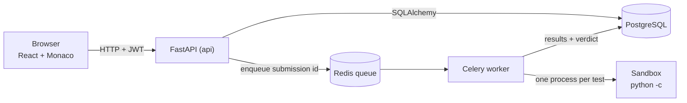

# CodeArena

An online judge for Python: solve problems in the browser, run your code on sample tests, and submit it to be judged against hidden tests.

## Features

### For users

- Create an account and sign in. The first page asks whether you are signing in as a user or an admin.
- Browse the problem list, filter it by difficulty, and see which problems you have solved or tried.
- Write Python in a Monaco editor. Your code is saved as a draft in the browser for each problem.
- Run your code on the sample tests and compare the expected and actual output for each one.
- Submit for judging against all tests. The page polls until a verdict is ready, then shows it with one colored square per test that ran.
- See your past submissions for a problem and load an old submission's code back into the editor.
- Dashboard: problems solved by difficulty, acceptance rate, total submissions and recent submissions.
- Light and dark mode.

### For admins

- A separate admin area with its own header, reached by choosing "Admin" on the sign-in page. Only accounts with `is_admin = true` get in.
- Overview: total, published and draft problems, counts by difficulty, and a list of problems that have no test cases or no visible test case.
- Problems table: publish or unpublish, edit, delete (with confirmation), and open a published problem on the site.
- Create and edit problems: title, description, difficulty, constraints, time limit, memory limit, published flag, and test cases that can be added, edited, removed and marked hidden.
- Preview a problem exactly as users will see it, before saving.

## Tech stack

| Area | Technology | Version |
| --- | --- | --- |
| API | FastAPI, Uvicorn | 0.115.6, 0.32.1 |
| ORM and migrations | SQLAlchemy, Alembic | 2.0.36, 1.14.0 |
| Database | PostgreSQL (psycopg driver) | 16 (psycopg 3.2.3) |
| Queue | Redis, Celery | Redis 7, celery 5.4.0, redis-py 5.2.1, kombu 5.4.2 |
| Auth | JWT (PyJWT), bcrypt | 2.10.1, 4.2.1 |
| Config and validation | pydantic-settings, email-validator | 2.6.1, 2.2.0 |
| Runtime | Python, Docker Compose | Python 3.12 |
| Frontend | React, React Router, Vite, Monaco editor (`@monaco-editor/react`) | ^18.3.1, ^6.28.0, ^5.4.11, ^4.6.0 |

Backend versions are pinned in [backend/requirements.txt](backend/requirements.txt). Frontend versions are the ranges in [frontend/package.json](frontend/package.json).

## Architecture



Docker Compose runs four services: `db` (PostgreSQL), `redis`, `api` (FastAPI) and `worker` (Celery). The frontend runs separately with the Vite dev server.

### Life of a submission

1. The browser sends `POST /submissions`. The API saves a submission row with status `QUEUED` and puts its id on the Redis queue.
2. The API returns right away with the submission id. The browser then polls `GET /submissions/{id}` every second.
3. A Celery worker picks up the job and sets the status to `RUNNING`.
4. The worker runs the code against each test case and saves a result row per test.
5. The worker saves the final verdict (for example `ACCEPTED` or `WRONG_ANSWER`) and the slowest test's time. The next poll sees a final status and the browser shows it.

If Redis is unreachable when the job is queued, the submission is marked `INTERNAL_ERROR` and the API returns 503. If the judging code raises an error partway through, the submission is marked `INTERNAL_ERROR` instead of staying `RUNNING`.

### Why judging is asynchronous

A submission can take several seconds: each test may run up to the time limit, and some problems have large hidden tests. Judging inside the request would tie up an API worker for that whole time, and a few slow or looping submissions could make the API unresponsive for everyone. With a queue, the API only writes a row and enqueues a job, and the number of programs running at once is capped by the worker's concurrency (2 in `docker-compose.yml`).

## How judging works

- **Separate process per test.** Each test runs the code as a new process (`python -c <code>`), with the test input on stdin. See [backend/app/engine/sandbox.py](backend/app/engine/sandbox.py).
- **Time limit.** Each process is stopped once it exceeds the problem's time limit (2 seconds by default). The recorded time is wall-clock time, including interpreter startup.
- **Output normalization.** Expected and actual output are compared line by line, after removing trailing spaces from each line and blank lines at the start and end. Leading spaces still matter. See [backend/app/engine/judge.py](backend/app/engine/judge.py).
- **Stop at the first failure.** Tests run in order, and judging stops at the first test that fails. That test's verdict becomes the submission's verdict.

### Verdicts

| Verdict | Meaning |
| --- | --- |
| `ACCEPTED` | Every test passed. |
| `WRONG_ANSWER` | The output did not match the expected output. |
| `TIME_LIMIT_EXCEEDED` | A test ran longer than the time limit. |
| `RUNTIME_ERROR` | The program exited with a non-zero code. The last 2,000 characters of stderr are saved. |
| `INTERNAL_ERROR` | The problem has no test cases, the job could not be queued, or the judge itself failed. |
| `QUEUED`, `RUNNING` | Not judged yet. |

`MEMORY_LIMIT_EXCEEDED` and `OUTPUT_LIMIT_EXCEEDED` exist in the status enum but are never produced yet, because memory and output limits are not enforced.

### Sample tests and hidden tests

Each test case is either a sample (`is_hidden = false`) or hidden (`is_hidden = true`).

- **Samples** are returned by `GET /problems/{id}` and shown on the problem page as examples. "Run samples" (`POST /submissions/run`) runs the code on the samples only, returns each case's output, and saves nothing.
- **Hidden tests** are used only by the worker when judging a submission, together with the samples. The API never sends their input or expected output to a normal user. A submission's results contain only the test id, verdict and time.

Hidden tests stay on the server because a user who could see them could hardcode the expected answers instead of solving the problem.

## Project structure

```text
codearena/
├── docker-compose.yml        # db, redis, api and worker services
├── .env.example              # backend settings: database, Redis, JWT, CORS
├── backend/
│   ├── Dockerfile            # Python 3.12 image shared by api and worker
│   ├── requirements.txt      # pinned backend dependencies
│   ├── alembic/              # migrations (versions/ holds the initial schema)
│   └── app/
│       ├── main.py           # FastAPI app, CORS, /health, router registration
│       ├── models.py         # SQLAlchemy models: users, problems, test_cases, submissions, submission_results
│       ├── seed.py           # loads five starter problems with sample and hidden tests
│       ├── core/             # settings (config.py), password hashing and JWT (security.py)
│       ├── db/               # database engine and session
│       ├── schemas/          # Pydantic request and response models
│       ├── api/              # routes: auth, users, problems, submissions, admin; deps.py has the auth dependencies
│       ├── engine/           # sandbox.py runs code, judge.py compares output
│       └── worker/           # Celery app and the judge_submission task
└── frontend/
    ├── package.json
    ├── vite.config.js        # dev server on port 5173 (strictPort)
    ├── .env.example          # VITE_API_URL
    └── src/
        ├── App.jsx           # routes and the user and admin layouts
        ├── api.js            # API client: bearer token, error formatting
        ├── auth.jsx          # signed-in user state, route guards for users and admins
        ├── problemView.jsx   # problem statement shared by the problem page and the admin preview
        ├── pages/            # sign-in, problems, problem, dashboard
        └── pages/admin/      # overview, problems table, problem form
```

## Getting started

You need Docker Desktop and Node.js. The commands below work in PowerShell and in Command Prompt, run from the repository root unless a step says otherwise.

1. Create the backend settings file, then open `.env` and set `JWT_SECRET` to a long random string.

   ```bash
   copy .env.example .env
   ```

   On macOS or Linux, use `cp .env.example .env`.

2. Build and start PostgreSQL, Redis, the API and the worker.

   ```bash
   docker compose up --build -d
   ```

3. Create the database tables.

   ```bash
   docker compose exec api alembic upgrade head
   ```

4. Load the starter problems. Running it again skips problems that already exist.

   ```bash
   docker compose exec api python -m app.seed
   ```

5. Check the API is up by opening http://localhost:8000/health in a browser. The interactive API docs are at http://localhost:8000/docs.

6. Start the frontend.

   ```bash
   cd frontend
   npm install
   npm run dev
   ```

   Open http://localhost:5173. The port must stay 5173, because that is the only origin allowed by `CORS_ORIGINS`. To use a different API address, copy `frontend/.env.example` to `frontend/.env` and set `VITE_API_URL`.

7. Create an account on the sign-in page (choose "User", then "Create account").

8. To make that account an admin, run this from the repository root, replacing `your_username`:

   ```bash
   docker compose exec db psql -U codearena -d codearena -c "UPDATE users SET is_admin = true WHERE username = 'your_username';"
   ```

   Then sign out, choose "Admin" on the sign-in page and sign in again.

PostgreSQL is also published on host port 5433 and Redis on 6379, if you want to connect with your own tools.

After changing backend code, the API reloads by itself, but the worker does not:

```bash
docker compose restart worker
```
